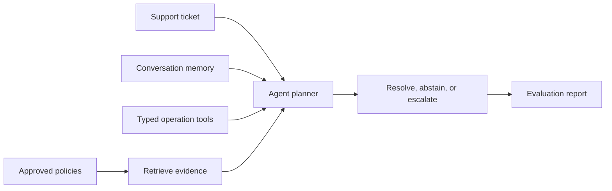

# Agent Project

Use this repository as a **template** for your agent project. Build a
Northstar operations assistant that resolves support tickets by
combining typed tool calls, retrieval over approved policies, and conversation
memory for follow-up requests. Create pull requests in your own copy even if you are working alone, and use them to track your progress.

This assignment follows the earlier lessons on
tool-calling agents, retrieval-augmented generation, and
conversation state. Unlike the lesson repositories, this project asks you to
make and justify system decisions in a complete assessed workflow.

## Learning Objectives

By the end of this repository, you should be able to:

- Design and build a task-oriented agent that integrates tool calling,
  retrieval, and conversation memory for a multi-step operations workflow.
- Evaluate agent behavior using task completion, tool-use correctness,
  retrieval grounding, memory use, and failure-recovery evidence.
- Decide when an agent should answer, abstain, or hand off to a human reviewer.

## Learning Path



| File / Folder | Description |
|---|---|
| [**Project Description**](project-description.md) | Scenario, milestones, deliverables, and acceptance checklist. |

### Additional Folders and Files

| File / Folder | Description |
|---|---|
| [**data/knowledge_base**](data/knowledge_base/) | Approved support policies the agent may cite. |
| [**data/operations**](data/operations/) | Tickets, customers, availability, and seed memory for the agent's tools. |
| [**data/evaluation**](data/evaluation/agent_cases.json) | Labeled cases for scoring the agent. |
| [**solution**](solution/README.md) | Runnable reference and tests. Inspect after attempting the project. |
| [**.env.example**](.env.example) | Execution mode, provider credentials, and local limits. |
| [**pyproject.toml**](pyproject.toml) | Project configuration and dependencies. |
| [**uv.lock**](uv.lock) | Dependency lock file. |

## Setup

Use [uv](https://docs.astral.sh/uv/getting-started/installation/) 0.13.5 or newer
and Python 3.13.17 or a newer 3.13 patch release, as defined in
[`.python-version`](.python-version).

> [!NOTE]
> Throughout these steps, text in angle brackets like `<repo-name>` is a **placeholder**. Replace it, including the `< >` brackets, with your own value. For example, `cd <repo-name>` becomes `cd mle-agent-project`.

### 1. Create the Repository from the Template

Click **Use this template** on GitHub.

When creating the repository:

- Set yourself as the **Owner**
- Choose a repository name
- Disable **Include all branches**
- Click **Create repository**

> [!IMPORTANT]
> If you are working in pairs or groups, only **one person** should complete this step.

---

### 2. Add Collaborators (Pairs/Groups Only)

If working with teammates:

1. Open the repository on GitHub
2. Go to **Settings → Collaborators**
3. Add your teammates as collaborators
4. Share the repository link with your team

Teammates should accept the invitation before continuing.

---

### 3. Clone the Repository

Copy the SSH URL from the **Code** button on GitHub, then run:

```bash
git clone <copied-ssh-url>
```

The copied SSH URL will look like `git@github.com:<your-username>/<repo-name>.git`.

---

### 4. Move into the Project Folder and Install Dependencies

The command below installs all dependencies and creates a virtual environment in `.venv/`.

```bash
cd <repo-name>
uv sync
```

The reference uses local fixtures and lexical retrieval, with Groq as the default PydanticAI provider. Set `LLM_PROVIDER=dry-run` explicitly for offline runs. Sentence Transformers and Qdrant remain available for your own retrieval implementation.

---

### 5. Set Up Environment Variables

Copy the execution mode, provider settings, and limits:

```bash
cp .env.example .env
```

Keep `LLM_PROVIDER=groq` and fill in `GROQ_API_KEY` for your first run. The reference loads `.env` from the repository root; exported environment variables take precedence.

For live model-controlled tool calling, set `LLM_PROVIDER` and its matching key:

- **Groq (primary):** `LLM_PROVIDER=groq`, `GROQ_API_KEY`, optional `GROQ_MODEL`.
- **Mistral (alternative):** `LLM_PROVIDER=mistral`, `MISTRAL_API_KEY`, optional `MISTRAL_MODEL`.
- **OpenRouter (optional):** `LLM_PROVIDER=openrouter`, `OPENROUTER_API_KEY`, optional `OPENROUTER_MODEL`. `OPENROUTER_FALLBACK_MODEL=openrouter/free` enables a server-side model backup; leave it blank to disable. Free accounts currently share [50 requests/day across free models](https://openrouter.ai/pricing).
- **Google AI Studio (optional):** `LLM_PROVIDER=google`, `GOOGLE_API_KEY`, `GOOGLE_MODEL=gemma-4-26b-a4b-it` for direct [Gemma access](https://ai.google.dev/gemma/docs/core/gemma_on_gemini_api), independent of OpenRouter. Free [rate limits](https://ai.google.dev/gemini-api/docs/rate-limits) vary by project and model; use only non-sensitive exercise data on the free tier.
- **OpenAI (optional, paid):** `LLM_PROVIDER=openai`, `OPENAI_API_KEY`, optional `OPENAI_MODEL`.

Only the selected provider is called. Missing keys and API errors never fall back to simulation or another API provider. Set `LLM_PROVIDER=dry-run` explicitly for offline runs; tests isolate this mode from local credentials. All tools still use local fixtures and create drafts, never real support updates.

> [!CAUTION]
> Never commit `.env`. It is git-ignored because environment files often hold secrets. Only `.env.example`, with placeholder or default values, belongs in the repository.

---

### 6. Open the Repository in VS Code

> [!NOTE]
> Make sure you open VS Code from the project root so it automatically detects the environment created by `uv sync`.

Launch VS Code in the project root folder:

```bash
code .
```

Select the Python interpreter in `.venv/` created by `uv sync`. Run the [reference solution commands](solution/README.md#run-the-reference-workflow) from the project root.

## Required Workflow

Work through the project in this order:

1. Validate the supplied ticket, policy, memory, and evaluation data.
2. Build typed tools for ticket lookup, customer context, policy retrieval,
   availability checks, ticket updates, and escalation drafts.
3. Index approved policy sources and preserve source IDs through retrieval and
   answer validation.
4. Implement short-term conversation memory plus durable case memory for
   follow-up turns.
5. Add bounded agent execution with tool-call limits, evidence thresholds,
   unsupported-question abstention, and human-review handoff.
6. Evaluate task completion, tool correctness, retrieval grounding, memory use,
   and failure recovery in a written report.

## References & Further Reading

- [PydanticAI Agents](https://pydantic.dev/docs/ai/agents/)
- [PydanticAI Function Tools](https://pydantic.dev/docs/ai/tools/)
- [PydanticAI Message History](https://pydantic.dev/docs/ai/core-concepts/message-history/)
