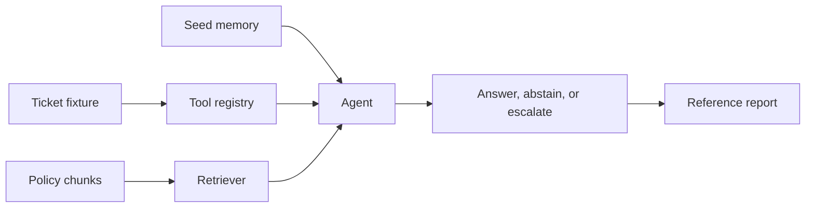

# Reference Solution

This folder contains a local reference baseline for the
Northstar Agent Project. It is modular: fixture validation,
policy loading, retrieval, operation tools, memory, agent orchestration, and
evaluation are separate responsibilities that can be inspected or replaced.

Groq is the default provider and requires `GROQ_API_KEY` in the root `.env`.
Mistral, OpenRouter, Google AI Studio, and OpenAI are alternatives for the same
PydanticAI planner. Set `LLM_PROVIDER=dry-run` explicitly to run the fixed-rule
baseline without API keys. Both paths
share local tools, retrieval, trace logging, citation validation, execution
budgets, and visible handoff outcomes. See the root [provider setup](../README.md#5-set-up-environment-variables).
Memory updates last for one agent instance; persistence across processes is
left to your project implementation.

Scripted ticket updates are generic drafts; the live model is asked for a
policy-specific next action. Neither mode sends updates or grants approval.
Fixture tools assume authorized access, not production authorization controls.
Rejected escalation attempts remain in the trace with their proposed recipient.
The report checks status, tool calls, and source IDs, not answer usefulness or
semantic grounding. Live results need human inspection.

## Read In Three Steps

1. Run one case below, then follow [agent.py](agent_project/agent.py) and
   [tools.py](agent_project/tools.py) from request to draft.
2. Inspect [retrieval.py](agent_project/retrieval.py) and
   [memory.py](agent_project/memory.py) when tracing evidence and follow-ups.
   Data validation and chunking are separate helpers, not extra project requirements.
3. Read [evaluation.py](agent_project/evaluation.py) alongside its report and
   tests to understand each check and its limitations.



## Run The Reference Workflow

All commands run from the repository root using the environment created by `uv sync`.

### 1. Validate The Data

```bash
uv run python -m solution.agent_project inspect-data
```

### 2. Inspect The In-Memory Index

```bash
uv run python -m solution.agent_project index
```

Each command rebuilds this tiny index in memory; no index is saved on disk.

### 3. Run One Evaluation Case

```bash
uv run python -m solution.agent_project run-case refund_duplicate_payment
```

### 4. Inspect A Chat-Style Case

```bash
uv run python -m solution.agent_project chat --case mfa_followup_memory
```

### 5. Generate The Evaluation Report

```bash
uv run python -m solution.agent_project evaluate
```

With `LLM_PROVIDER=dry-run`, this writes `reports/local_evaluation.md` at the
repository root. Live mode instead writes
`reports/local_live_evaluation.md`, labeled with the provider and model. Use
`evaluate --output <path>` to choose another local destination. The checked-in
[reference report](reports/reference_evaluation.md) remains unchanged; the CLI
rejects that destination to prevent accidental overwrites.

### 6. Run Tests

```bash
uv run python -m pytest solution/tests
```

## Implementation Decisions

### Why keep a rule-based baseline?

Agent evaluation needs stable traces. The reference implementation makes tool
selection and answer outcomes inspectable alongside the live planner in
[live.py](agent_project/live.py). Regression tests use scripted model replies
to exercise the real PydanticAI loop without API calls.

### Why validate citations?

Generated text is untrusted output. The agent accepts only citations that came
from retrieved policy evidence and records a safety event when retrieved text
contains instruction-attack markers. This simple filter illustrates a failure
boundary; it is not a general prompt-injection defense.

In dry-run mode, each tool call is one step. In live mode, `MAX_AGENT_STEPS`
bounds model requests separately from `MAX_TOOL_CALLS`. Each request has a
30-second timeout, a 2,048-output-token limit, and no HTTP retries. One tool/schema
correction is allowed within the same request budget. A run
can use several requests, so running all cases may exceed a provider's free quota.
Budget exhaustion requires review; API and schema errors stay visible rather
than becoming successful scripted answers. Increase limits deliberately if a
live model needs more turns. Independent evaluation cases start with seed memory
and empty message history; consecutive `run_case` calls on one instance retain
both until evaluation resets them.

The default eight model requests allow six sequential tool calls plus a final
answer and one correction.

The request must match the ticket or accepted evidence under the same lexical
threshold. This conservative check can reject paraphrases or vague follow-ups;
it is not semantic understanding. Unavailable handoff owners require review.

### What does the report measure?

- Expected status match checks the final status, not task usefulness.
- Required tool coverage checks tool names, not all arguments or extra calls.
- Exact source-ID match compares cited IDs, not semantic support for the answer.
- Expected memory-flag match checks whether follow-up context was used as labeled.
- Outcome rule consistency checks status, handoff rules, and any case-specific
  forbidden calls or required safety events.

`MIN_SCORE` is a teaching default, not independently calibrated. These supplied
cases test regressions; do not tune on them and present their scores as held-out
performance.
